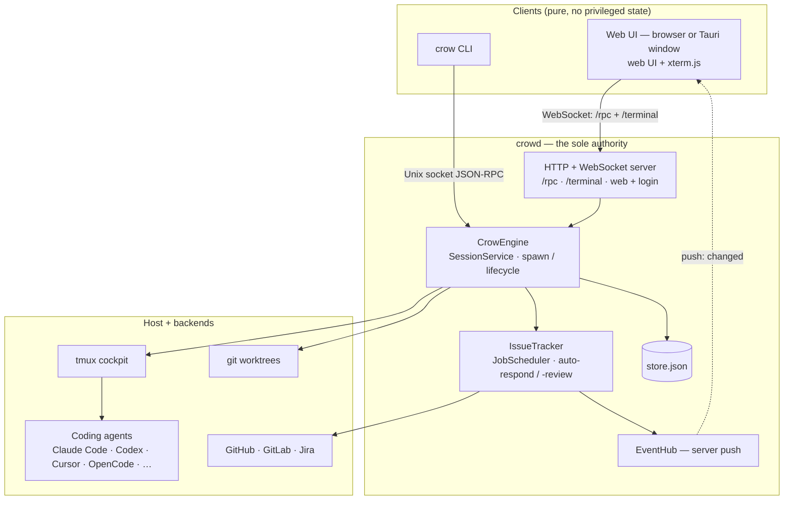

# Crow

Crow is a self-hosted daemon and web UI for running AI coding agents — Claude Code, Codex, Cursor, OpenCode and others — in parallel, each in its own git worktree, driven by your GitHub, GitLab or Jira board.

**Why.** One coding agent in one terminal is easy. Five at once is not: each needs its own branch and checkout so they don't trample each other, someone has to remember which terminal belongs to which ticket, and every PR needs watching for review comments, failed checks and merge conflicts. Crow does that bookkeeping. Pick a ticket and it creates the worktree, launches the agent with the ticket as context, moves the ticket across your board, and tracks the PR until it merges. It can also review PRs, answer review feedback, and rebase stale branches on its own.

**Who it's for.** Developers who already work with a coding agent and want to run several tickets at once without losing track of them. Crow runs on your own machine (or a box you control) and drives the `git`, `gh`/`glab` and agent CLIs you've already installed and logged into — it isn't a hosted service.


## Install

There is no stable release yet. [Prereleases](https://github.com/corveil/crow/releases) carry macOS builds, but until a stable release is published, **building from source is the supported way to install Crow**. When one ships, a download path will go here, above the source build.

### Build from source

You need the [prerequisites](#prerequisites) below — at minimum a Swift 6 toolchain, `git`, `tmux` and a coding agent.

```bash
# 1. Clone
git clone https://github.com/corveil/crow.git
cd crow

# 2. Build the `crow` CLI and the `crowd` daemon (Swift toolchain only).
#    `make build` also builds the optional native desktop app — see "Desktop app" below.
make daemon

# 3. Authenticate the GitHub CLI (GitHub workspaces only) — the write `project` scope is required
gh auth login
gh auth refresh -s project,read:org,repo

# 4. Configure your development root + workspaces
.build/debug/crow setup

# 5. Run the daemon — it serves the web UI
.build/debug/crowd
```

`crowd` prints `HTTP/WS listening on http://127.0.0.1:8787` on startup — open that URL in your browser. The first screen guides you through any remaining setup.

> **Note:** The required GitHub scope is the **write** `project` scope — `read:project` is insufficient because Crow updates ticket status via the `updateProjectV2ItemFieldValue` GraphQL mutation. See [docs/getting-started.md](docs/getting-started.md#3-github-authentication) for details.

### Put `crow` + `crowd` on your PATH

The Manager terminal and the `/crow-workspace` skill call bare `crow ...`, so a build you can only launch by full path will break those workflows. Install the binaries so they're invokable from anywhere:

```bash
make install                       # symlinks crow + crowd into ~/.local/bin
```

If `~/.local/bin` isn't already on your `PATH`, add this to `~/.zshrc` (then restart your shell):

```bash
export PATH="$HOME/.local/bin:$PATH"
```

Use a different directory with `BINDIR`, e.g. `make install BINDIR=/usr/local/bin`.

`make install` creates **symlinks** into `.build/debug/`, so a later `make build` updates them in place — no need to re-run it. Re-run `make install` only when you switch to a release build (`make daemon CONFIG=release && make install CONFIG=release`) or after `make clean` (which removes `.build/` and leaves the symlinks dangling until the next build). Remove the symlinks with `make uninstall`.

To start `crowd` automatically at login, see `crow autostart install` in the [CLI reference](docs/cli-reference.md#autostart).

### Remote access

`crowd` binds `127.0.0.1:8787` by default, so it's reachable only from the machine it runs on. To reach it from another device, front it with an HTTPS reverse proxy (e.g. [`tailscale serve`](https://tailscale.com/kb/1242/tailscale-serve)) and set a **web password** under **Settings → Web Access** or with `crow web-password set`. Non-loopback requests are blocked until a password is set and the connection is HTTPS.

The password and the AI gateways are **local-only** surfaces: they're settable from a local browser or the `crow` CLI (which talks over the Unix socket), and refused for remote web clients — a remote session must not be able to change the password gating remote access, or read gateway credentials. See [CLI Reference → Gateway Commands](docs/cli-reference.md#gateway-commands).

## Prerequisites

### System Requirements

`crowd` is the only process you run, and it drives `git`, `tmux`, and the coding agents on the host — so it needs a Unix-like host:

- **macOS 14.0+** (Sonoma or later), or **Linux** (x86_64 or arm64). Windows isn't supported.
- A **Swift 6 toolchain** — bundled with Xcode Command Line Tools on macOS, or installed from [swift.org/install](https://www.swift.org/install/) on Linux
- A modern **web browser** for the UI

### Build Dependencies

| Tool  | Version | Purpose                     | Install                  |
| ----- | ------- | --------------------------- | ------------------------ |
| Swift | 6.0+    | Compiler — Xcode CLT (macOS) or the swift.org toolchain (Linux) | `xcode-select --install` · [swift.org/install](https://www.swift.org/install/) |
| Rust  | 1.77+   | Only for the optional [desktop app](#desktop-app-native-window-over-crowd) | [rustup.rs](https://rustup.rs) |

### Runtime Dependencies

| Tool     | Purpose                                                       | Install                                               |
| -------- | ------------------------------------------------------------- | ----------------------------------------------------- |
| `git`    | Worktree management                                           | Ships with Xcode CLT                                  |
| `tmux`   | Terminal backend for managed sessions (≥ 3.3)                 | `brew install tmux`                                   |
| `claude` | Claude Code — the default coding agent                        | [claude.ai/download](https://claude.ai/download)      |
| `gh`     | GitHub CLI — issues, PRs, project boards. **Only for GitHub workspaces** | `brew install gh`                          |
| `glab`   | GitLab CLI. **Only for GitLab workspaces**                    | `brew install glab`                                   |
| `acli`   | Atlassian CLI. **Only for workspaces that track tickets in Jira** | [developer.atlassian.com/cloud/acli](https://developer.atlassian.com/cloud/acli/guides/install-acli/) |

> Install commands above are macOS/Homebrew; on Linux use your distribution's package manager (e.g. `apt install git tmux`; `gh`/`glab` have their own apt repos). `claude` is the default coding agent — **Codex**, **Cursor**, **OpenCode**, **Grok Build**, **Antigravity**, and **Muse Code** are also supported and selectable per session (Settings → General, or `crow agents set`); install whichever agents you use. An uninstalled agent still appears in the picker, greyed out. What each one can and can't do is in the [agent harness matrix](docs/agent-harness-matrix.md).

## Architecture at a glance



`crowd` is the single source of truth — the only store writer, the only spawner, and the owner of terminal + agent lifecycle. Every UI is a **pure client**: it subscribes to `crowd`'s state over the `/rpc` + `/terminal` WebSocket surface, sends JSON-RPC, and renders. The **web UI** is the same either way — a browser tab or the **Tauri desktop window**, which just wraps that web UI in a native window and can spawn `crowd` as a sidecar on launch. Multiple clients (browser tabs, the desktop window, the `crow` CLI, any future UI) attach to one running system at once. Full detail in [docs/architecture.md](docs/architecture.md).

> **History:** Crow began as a native macOS (AppKit) app. Per [ADR 0009](docs/adr/0009-crowd-sole-authority-clients-only.md) and [ADR 0010](docs/adr/0010-retire-the-macos-app.md) that app was retired: `crowd` is the sole authority and every UI is a pure client.

## Desktop app (native window over crowd)

Prefer a native window to a browser tab? `crow-desktop/` is a thin **Tauri** shell that opens a "Crow" window pointed at the same web UI. It doesn't reimplement anything — `crowd` stays the sole authority; the window is just another pure client. It needs a Rust toolchain.

```bash
make run       # build crowd + the desktop app, then open the Crow window
```

On launch the window looks for a `crowd` already listening on `127.0.0.1:8787`. If it finds one, it **reuses** it and leaves it running when you quit. If not, it spawns its own `crowd` — `.build/debug/crowd` in a debug build, the bundled sidecar inside `Crow.app` in a release build — and stops it on quit.

**Platforms:** prebuilt for macOS only. The shell's macOS-specific code is `cfg`-gated, so it is meant to compile on Linux with `cargo`, but `make` doesn't build it there and it isn't tested or released for Linux — on Linux, use the browser. Windows isn't supported, because `crowd` needs a Unix host with tmux.

Working on the desktop shell or the web UI? See [docs/development.md](docs/development.md).

## Documentation

**Using Crow**

- [**Getting Started**](docs/getting-started.md) — Clone, build, authenticate, and run
- [**Configuration**](docs/configuration.md) — File locations, workspace config, directory layout, session lifecycle
- [**Automation**](docs/automation.md) — Auto-create, auto-respond, auto-complete, and the Settings → Automation tab
- [**Web UI skins**](docs/web-skins.md) — The built-in color skins and how to make your own
- [**MCP**](docs/mcp.md) — Crow's read-only MCP server: pointing Cowork or an off-box bot at the board
- [**Troubleshooting**](docs/troubleshooting.md) — Build and runtime errors

**CLI**

- [**CLI Reference**](docs/cli.md) — The canonical reference: every `crow` subcommand and flag, generated from the commands themselves (`make docs`), so it can't drift
- [**CLI Guide**](docs/cli-reference.md) — The companion guide: what each verb is for, JSON response shapes, worked examples and gotchas. A test keeps it covering every verb in the reference

**Agents and session logs**

- [**Agent harness matrix**](docs/agent-harness-matrix.md) — What each supported coding agent can and can't do under Crow, and why
- [**Session-log collector**](docs/session-log-collector.md) — Uploading agent transcripts to Corveil, per workspace
- [**Session backfill**](docs/session-backfill.md) — Uploading transcripts that predate the collector
- [**Harness transcript locations**](docs/harness-transcript-locations.md) — Where each agent writes its transcripts on disk

**Development**

- [**Development**](docs/development.md) — Dev loops for `crowd`, the web UI and the desktop shell; adding packages; tests
- [**Architecture**](docs/architecture.md) — Packages, key components, data flow
- [**Architecture Decision Records**](docs/adr/README.md) — Why Crow is built the way it is
- [**macOS release signing**](docs/macos-release-signing.md) — How release builds are signed and notarized
- [**Harness gap audit**](docs/agent-harness-gap-audit.md) — Version-pinned audit behind the harness matrix
- [**Terminal runtime research**](docs/terminal-runtime-research.md) — Archived: the original Ghostty-era terminal investigation

## Usage

### The Web UI

The left rail groups your work:

- **Tickets** — Assigned issues grouped by project board status (Backlog, Ready, In Progress, In Review, Done in last 24h). Click a status to filter.
- **Manager** — A persistent Claude Code terminal for orchestrating work. Use `/crow-workspace` here to create new sessions. Launches in `--permission-mode auto` by default so orchestration commands (`crow`, `gh`, `git`) skip per-call approval (recent Claude Code versions can still prompt once for a file read outside your dev root); opt out via Settings → Automation → Manager Terminal.
- **Active Sessions** — One per work context. Shows repo, branch, issue/PR badges with pipeline and review status.
- **Completed Sessions** — Sessions whose PRs have been merged or issues closed.

Right-click a session (or **long-press** / tap the **⋮** button on touch devices) for its actions — rename, delete, copy links, and more.

### Creating a Session

In the Manager tab, tell Claude Code what you want to work on:

```
/crow-workspace https://github.com/org/repo/issues/123
```

Or use natural language:

```
/crow-workspace "add authentication to the acme-api API"
```

This will:

1. Create a git worktree with a feature branch
2. Create a session with ticket metadata
3. Launch Claude Code in plan mode with the issue context
4. Auto-assign the issue and set its project status to "In Progress"

## Features

### Ticket Board

- Pipeline view showing issues by project board status
- Click a status to filter the list
- "Start Working" / "Start Exploring" split-button creates a workspace from an issue (explore is read/explain only)
- Issues linked to active sessions show a navigation button; explore sessions carry an Exploring badge
- Scriptable from the CLI: `crow list-tickets`, `crow work-on-issue`, `crow explore-issue`, `crow batch-work-on-issues`, `crow start-review`, and `crow quick-action` drive the same actions as the board buttons (see the [CLI Reference](docs/cli-reference.md))

### Jira tasks + GitHub code (cross-backend workspaces)

Per [ADR 0005](docs/adr/0005-task-and-code-backend-protocols.md), a workspace's
**Task Backend** (where tickets live) is chosen independently of its **Code
Backend** (where code + PRs live). You can track work in **Jira** while keeping
code and pull requests on **GitHub** — the task side runs through `acli`, the PR
side still runs through `gh`.

**Prerequisite — authenticate `acli`:**

```bash
# Install: https://developer.atlassian.com/cloud/acli/guides/install-acli/
acli jira auth login
acli jira auth status   # should print "✓ Authenticated"
```

**Configure a Jira-task / GitHub-code workspace** (Settings → Workspaces → edit a
workspace):

- **Code Backend** → `GitHub` (code + PRs stay on GitHub).
- **Task Backend** → `Jira` (offered only when `acli` is installed + authenticated;
  an inline hint tells you the fix when it isn't).
- **Atlassian Site** (e.g. `acme.atlassian.net`) — used to build `…/browse/KEY` links.
- **Project Key** (e.g. `PROJ`) — default project for created tickets.
- **My-tickets JQL** (optional) — defaults to
  `assignee = currentUser() AND statusCategory != Done`.

Settings persist to the workspace entry (`~/.claude/workspace-repos.json` keys:
`taskProvider`, `jiraProjectKey`, `jiraJQL`, `jiraSite`). Existing GitHub/GitLab
workspaces are unaffected — when no Task Backend is set, it follows the Code
Backend (GitHub code ⇒ GitHub issues, as before).

### PR Status Tracking

- Pipeline checks (passing/failing/pending)
- Review status (approved/changes requested/needs review)
- Merge readiness (mergeable/conflicting/merged)
- Purple badge with checkmark for merged PRs

### Auto-Complete

- Sessions automatically move to "Completed" when their linked PR is merged or issue is closed
- Checked every 60 seconds during the issue polling cycle
- Requires positive evidence the session was worked, so an unrelated PR merge can't flip an idle session

### Automation Suite

Crow can drive a ticket from assignment to merged with minimal manual steps. Toggles live under **Settings → Automation**; full walkthrough in [docs/automation.md](docs/automation.md).

- **Auto-create workspace** when an issue assigned to you is labeled `crow:auto` (or an exploration session when labeled `crow:explore`)
- **Auto-suggest opening a PR** if a session completes with no PR linked
- **Auto-start review sessions** for opted-in workspaces when a PR becomes reviewable
- **Auto-respond** to changes-requested reviews and failed CI checks (off by default)
- **Auto-merge** Crow-authored PRs labeled `crow:merge` via `gh pr merge --auto --squash` (off by default; only acts on PRs whose commits carry a `Crow-Session:` trailer matching a known session). Crow lazily creates the `crow:merge` label on first observation; to pre-seed it manually: `gh label create crow:merge --color 0E8A16 --description "Crow: enable auto-merge once mergeable"`
- **Scriptable** — `crow automation get|set` drives every toggle on the tab: the five auto-permission modes, remote control, commit attribution, both label watchers, and the auto-respond toggles. Same config as the UI, live within a board poll, no `crowd` restart. The tab's ticket/review board filters are global defaults and belong to `crow defaults set` ([CLI reference](docs/cli-reference.md#automation-commands))

### Review Board

- Multi-select with batch Start Review
- Bulk delete sessions
- Filter projects out via `excludeReviewRepos`
- Quick action buttons on the session detail header (open PR, mark in review, copy branch)
- Move completed sessions back to active

### Terminals

- xterm.js terminal surface in the browser, streamed from tmux over a WebSocket (`/terminal`)
- tmux-backed managed terminals — each session is a tmux window on a shared server (the "cockpit"), so per-session shells stay alive across UI navigation and across browser reconnects. Requires `tmux ≥ 3.3` (`brew install tmux`); without it, managed terminals don't render. See [docs/architecture.md#terminal-backends](docs/architecture.md#terminal-backends).
- Rename tabs from the UI or via `crow rename-terminal`
- tmux maintenance from the CLI as well as Settings → About: `crow restart-manager`, `crow restart-tmux-server`, `crow reload-tmux-config`, `crow launch-agent`, `crow retry-readiness`, plus `crow open-in-vscode` / `crow open-terminal` for the session's worktree on the host. See [docs/cli-reference.md](docs/cli-reference.md#maintenance-commands).

### Workspaces

- A workspace maps a folder under your dev root to a forge (GitHub or GitLab), a ticket source (GitHub, GitLab, or Jira), the repos it always lists or auto-reviews, and free-text instructions appended to its session prompts
- Manage from Settings → Workspaces or from the CLI with `crow workspace list|get|add|edit|remove` — both write the same config, and an open browser tab picks up a CLI change within a couple of seconds
- Renaming or removing a workspace is guarded: sessions are tied to it only by their worktree path and jobs only by its name, so both refuse while references exist and report what `--force` would orphan. See [docs/cli-reference.md](docs/cli-reference.md#workspace-commands).

### Notifications

- Events for task complete, agent waiting, review requested, changes requested and CI failing, plus the automation events Crow emits when it acts on your behalf (auto-created workspace, auto-merge enabled or blocked, branch rebased, rebase conflicts or stuck) and a config reload. `crow notifications get` lists them all
- Cascading control: a master mute, global sound / system-notification toggles, then per-event toggles and a sound picked from 14 built-in sounds
- Manage from Settings → Notifications or from the CLI with `crow notifications get|set` — both write the same config, and an open browser tab picks up a CLI change within a couple of seconds

### Orphan Recovery

- On startup, scans git worktrees across all repos
- Worktrees not tracked in the store are automatically recovered as sessions
- Fetches ticket metadata and PR links from GitHub for recovered sessions

### Safe Deletion

- Deleting a session on a protected branch (main, master, develop) only removes the session metadata — the repo folder and branch are preserved
- The delete confirmation dialog reflects this, showing "Remove Session" instead of "Delete Everything"

## Contributing

We welcome contributions! See [CONTRIBUTING.md](CONTRIBUTING.md) for guidelines on reporting bugs, suggesting features, and submitting pull requests, and [docs/development.md](docs/development.md) for dev loops, adding packages, and running tests.

## License

Apache 2.0 — see [LICENSE](LICENSE) for details.
